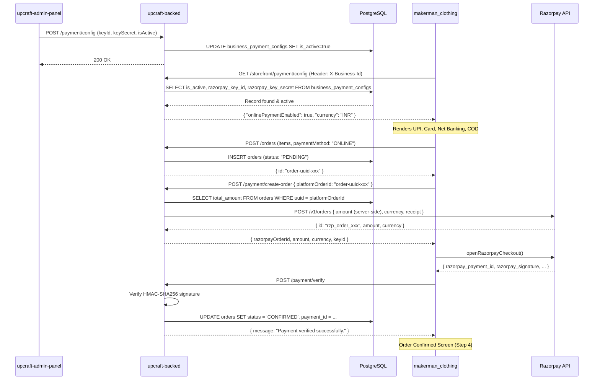

# Makerman Clothing - Razorpay Online Payment Integration Plan

## Status
Completed

## Module Overview
- **Problem**: In `makerman_clothing` storefront, all 4 payment options (UPI, Card, Net Banking, COD) are always displayed at checkout, even when client hasn't configured or has disabled Razorpay in `upcraft-admin-panel`. When customers attempt online payment while gateway is unconfigured or disabled, order creation fails unexpectedly.
- **Goal**: Dynamically gate online payment options on `makerman_clothing` based on tenant Razorpay configuration in `upcraft-backed` set via `upcraft-admin-panel`. When active, show UPI / Card / Net Banking / COD. When inactive/unconfigured, show only Cash on Delivery with explanatory notice and auto-select COD.
- **Target Users**: Storefront customers checking out garments; store administrators configuring payments in admin dashboard.
- **Out of Scope**: Alternative payment gateways (Stripe, PhonePe PG, Cashfree); automatic multi-currency conversion (INR only).

## Tech Stack
- **Backend (`upcraft-backed`)**: Java 21, Spring Boot 3.x, Spring Security, Spring Data JPA, PostgreSQL, Liquibase, Razorpay Java/HTTP Client.
- **Admin Panel (`upcraft-admin-panel`)**: React 18, TypeScript, Vite, TanStack Query, Tailwind CSS, Ant Design.
- **Storefront (`makerman_clothing`)**: React 18, TypeScript, TanStack Router, TanStack Query, Tailwind CSS, Razorpay Checkout SDK.

## Requirements
### Version 1 - 29-10-2026
- **REQ-1**: Backend must provide an unauthenticated public endpoint `GET /storefront/payment/config` returning `{ onlinePaymentEnabled: boolean, currency: string }`.
- **REQ-2**: Online payment is only enabled when tenant record in `business_payment_configs` has `is_active = true`, `razorpay_key_id IS NOT NULL`, and `razorpay_key_secret IS NOT NULL`.
- **REQ-3**: Security configuration must allow public access to `/storefront/payment/**` without JWT authentication.
- **REQ-4**: Storefront must fetch payment config using a dedicated query hook (`usePaymentConfig`) with 5-minute cache (`staleTime: 5m`).
- **REQ-5**: Checkout payment step must display skeleton loader while payment configuration is loading.
- **REQ-6**: If online payment is disabled or unconfigured:
  - Only Cash on Delivery is shown in the payment selection grid.
  - Active selection is automatically forced to COD.
  - Informational alert banner clarifies that store currently accepts COD only.
- **REQ-7**: If online payment is enabled:
  - All payment options (UPI, Card, Net Banking, COD) are rendered.
  - Existing Razorpay checkout modal opens seamlessly on "Pay Online via Razorpay".
- **REQ-8**: Server-authoritative order amount and HMAC-SHA256 signature verification remain strictly enforced in backend.

## Non-Functional Requirements
- **Response Time Target**: `GET /storefront/payment/config` p95 < 20ms (single indexed lookup by `business_id`).
- **Availability**: Graceful fallback to COD if endpoint fails or network error occurs (`onlinePaymentEnabled: false`).
- **Load (ASSUMPTION)**: Average 50 rps across storefronts; peak 500 rps during flash sales. Lightweight read cacheable at client/CDN level.

## Options Considered
| Option | Pattern | DB Queries | Effort | Risk | Decision |
|---|---|---|---|---|---|
| **Option 1: New Storefront Endpoint `GET /storefront/payment/config`** | Dedicated Storefront View Projection | 1 query on indexed `business_id` | S | Minimal | **Chosen**: Clean separation of concerns, public, cacheable, matches `/storefront/banners` pattern. |
| **Option 2: Embed into `GET /businesses/store-profile`** | Monolithic Store Profile DTO | 1 combined query | M | Moderate | **Rejected**: Bloats store profile payload; violates Single Responsibility; difficult to scale to multiple gateway configs. |
| **Option 3: Hardcode toggle in storefront env** | Static Build Flag | 0 queries | S | High | **Rejected**: Breaks client ability to toggle Razorpay live from admin dashboard without rebuilding frontend. |

## Architecture & Design


### Planned Classes & DTOs
1. `com.upcraft.platform.dto.StorefrontPaymentConfigDTO`:
   - `boolean onlinePaymentEnabled`
   - `String currency`
2. `com.upcraft.platform.controller.StorefrontPaymentController`:
   - `GET /storefront/payment/config` -> returns `ResponseEntity<StorefrontPaymentConfigDTO>`
3. `com.upcraft.platform.security.SecurityConfig`:
   - Add `.requestMatchers("/storefront/payment/**").permitAll()`
4. `makerman_clothing/src/hooks/use-api.ts`:
   - `interface StorefrontPaymentConfig`
   - `function usePaymentConfig()`
5. `makerman_clothing/src/routes/checkout.tsx`:
   - Update `CheckoutPage` to consume `usePaymentConfig`, filter methods, render skeleton and banner.

## API Endpoints
### `GET /storefront/payment/config`
- **Auth**: None (Public)
- **Headers**: `X-Business-Id: <UUID>`
- **Response**: `200 OK`
```json
{
  "onlinePaymentEnabled": true,
  "currency": "INR"
}
```
- **Target p95**: < 20ms

## Database Design
- Uses existing table `business_payment_configs`:
  - `business_payment_config_id` (BIGSERIAL PK)
  - `business_id` (VARCHAR(36) UNIQUE INDEX `uk_payment_config_business`)
  - `razorpay_key_id` (VARCHAR(255))
  - `razorpay_key_secret` (TEXT, AES-GCM encrypted)
  - `is_active` (BOOLEAN NOT NULL)
  - `created_at`, `updated_at` (TIMESTAMP)
- **No schema migration needed** (Table and indexes already present in Liquibase changelogs).

## Performance & Complexity Analysis
| Endpoint | DB queries | Time complexity | Index used | Max payload | Target p95 | Risk |
|---|---|---|---|---|---|---|
| `GET /storefront/payment/config` | 1 | O(1) | `uk_payment_config_business` | ~60 bytes | < 20ms | Low; client caches for 5 mins |

## Scalability & Load Plan
- **Caching**: TanStack Query stale time set to 5 minutes (`staleTime: 1000 * 60 * 5`). Only 1 request per user session every 5 minutes.
- **Connection Protection**: Fast read-only query returning immediately; negligible HikariCP footprint.
- **Degradation**: If backend fails or times out, hook defaults to `onlinePaymentEnabled: false`, allowing customer to still place order via COD.

## Security & Risks
- **Credential Protection**: `razorpay_key_secret` and `razorpay_key_id` are **never** returned in the public storefront endpoint. Key ID is only provided during authenticated order creation.
- **Amount Tampering Protection**: Order amount for Razorpay order creation is derived exclusively server-side from `orders.total_amount` in DB.
- **Replay Protection**: Callback verification confirms HMAC-SHA256 signature and matches `razorpayOrderId` with DB record.

## Test & Load Verification
- **Unit / Mockito**:
  - `StorefrontPaymentControllerTest`: config exists & active -> `true`
  - `StorefrontPaymentControllerTest`: config exists & inactive -> `false`
  - `StorefrontPaymentControllerTest`: config missing -> `false`
  - `StorefrontPaymentControllerTest`: keys null -> `false`
- **Integration Test**:
  - Public HTTP call to `/storefront/payment/config` without Authorization header -> `200 OK`.
- **Manual Verification**:
  - Toggle off in Admin -> checkout shows COD + alert banner.
  - Toggle on in Admin -> checkout shows UPI, Card, Net Banking, COD.

## Rollout & Rollback
- **Rollout**: Deploy backend changes first (non-breaking, new endpoint). Deploy storefront update second.
- **Rollback**: If frontend fails, rollback `checkout.tsx` and `use-api.ts`. Backend endpoint is harmless and backward compatible.

## Implementation Checklist
### Phase 1: Backend (`upcraft-backed`)
- [x] Create `StorefrontPaymentConfigDTO.java`
- [x] Create `StorefrontPaymentController.java`
- [x] Add route permit in `SecurityConfig.java`
- [x] Run backend compile and unit test


### Phase 2: Storefront (`makerman_clothing`)
- [x] Add `StorefrontPaymentConfig` and `usePaymentConfig` to `src/hooks/use-api.ts`
- [x] Update `src/routes/checkout.tsx` with dynamic method filter, skeleton, banner, auto-COD
- [x] Verify TypeScript compilation with `npx tsc --noEmit`

### Phase 3: QA & Verification
- [x] Unit test `StorefrontPaymentControllerTest` (5/5 passed)
- [x] Storefront build & type check verified (`npx vite build` exit code 0)
- [x] Defensive submission guard and button disabled state implemented in `checkout.tsx`
- [x] Manual QA ready (admin panel payment toggle / credentials)

## Change History
| Date | Change Description | Old Requirement (Commented) |
|---|---|---|
| 29-10-2026 | Initial plan created | - |

