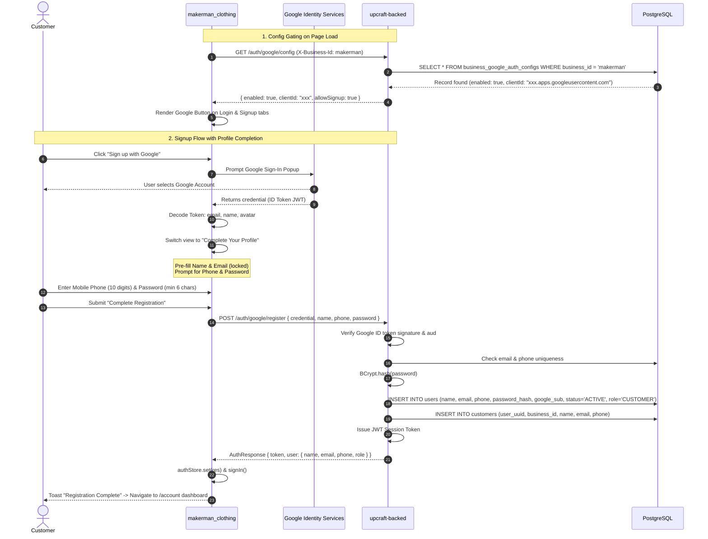

# Makerman Clothing - Google Authentication & Profile Completion Plan

## Status
Completed

## Module Overview
- **Problem**: In the Makerman storefront (`makerman_clothing`), authentication is currently restricted to manual email/password and email OTP flows. Although tenant Google OAuth infrastructure exists in `upcraft-backed` and `upcraft-admin-panel`, it is not surfaced on Makerman customer login or registration views. Additionally, customers signing up via Google must not be left as password-less, phone-less stub records; business logic requires that all registered Makerman customers have a complete profile (mandatory 10-digit mobile number) and an account password.
- **Goal**:
  1. Dynamically gate the visibility of the Google Sign-In button on Makerman's `/account` login and signup tabs based on the tenant's Google OAuth configuration in `upcraft-backed`. When enabled by the client in `upcraft-admin-panel`, display the Google Sign-In button; when disabled or unconfigured, completely hide the button.
  2. Provide a seamless Google Sign-In flow for returning customers on the Login tab.
  3. Provide a guided 2-step registration flow for new customers on the Signup tab: upon Google authorization, capture the verified email and name, prompt the customer to complete their profile (mandatory phone number) and set a password, and register them as an active customer.
- **Target Users**: Retail storefront customers authenticating on Makerman; store administrators configuring integrations in `upcraft-admin-panel`.
- **Out of Scope**: Third-party OAuth providers other than Google (e.g. Apple, Facebook); SMS-based OTP verification (email/in-app verification remains default).

## Tech Stack
- **Backend (`upcraft-backed`)**: Java 21, Spring Boot 3.x, Spring Security 6.x, Spring Data JPA, PostgreSQL, Google API Client Token Verifier (`GoogleTokenVerifier.java`), BCrypt Password Encoder.
- **Storefront (`makerman_clothing`)**: React 18, TypeScript, TanStack Router, TanStack Query, Tailwind CSS, Google Identity Services (GIS SDK loaded dynamically via `src/lib/google-auth.ts`).
- **Admin Panel (`upcraft-admin-panel`)**: React 18, TypeScript, Vite, TanStack Query, Google OAuth Settings in `IntegrationsPage.tsx`.

## Requirements
### Version 1 - 30-10-2026
- **REQ-1 (Config Gating)**: The storefront must query `GET /auth/google/config` with `X-Business-Id` on load using a dedicated TanStack Query hook (`useGoogleAuthConfig`) with a 5-minute cache (`staleTime: 5m`).
- **REQ-2 (Conditional Rendering)**:
  - If `enabled === true` and a valid `clientId` is returned, display a branded "Continue with Google" button on the **Login** tab and "Sign up with Google" on the **Register** tab.
  - If `enabled === false` or unconfigured, the Google button and its dividing separator ("or continue with") must be completely hidden.
- **REQ-3 (Returning Customer Login Flow)**:
  - When a customer clicks "Continue with Google" on the Login tab, Google One Tap / popup prompts authentication.
  - The returned Google credential (ID token JWT) is sent to `POST /auth/google`.
  - If the user exists and has a complete profile (active status, phone number present), the backend immediately issues an `AuthResponse` (JWT session token + user profile).
  - The storefront updates `authStore`, calls `signIn()`, and redirects the customer to their account dashboard.
- **REQ-4 (Unregistered Customer on Login Tab)**:
  - If a customer attempts Google login on the Login tab but has no account in the database:
    - If `allowSignup === false`: return a descriptive error (`"No account found for this Google email. Please register first."`).
    - If `allowSignup === true`: transition the customer automatically into the Signup profile completion step with Google details pre-filled.
- **REQ-5 (New Customer Signup Flow - Profile Completion)**:
  - When a customer clicks "Sign up with Google" on the Register tab:
    - Customer authenticates with Google and receives verified credentials.
    - Storefront transitions to a "Complete Profile" registration view.
    - Full Name is pre-filled from Google profile (editable).
    - Email is pre-filled from Google profile (read-only with verified Google badge).
    - Customer MUST enter a valid 10-digit mobile phone number.
    - Customer MUST set a password (minimum 6 characters).
- **REQ-6 (Backend Google Registration Endpoint)**:
  - Backend must provide an endpoint `POST /auth/google/register` accepting `GoogleCustomerRegisterRequest`:
    `{ credential: String, name: String, phone: String, password: String }`.
  - The backend verifies the Google ID token via `GoogleTokenVerifier`, validates phone format and uniqueness within the tenant, encodes the password using BCrypt, creates the `User` and `Customer` records in `ACTIVE` status, links `googleSub`, and returns the `AuthResponse` session.
- **REQ-7 (Content Security Policy Update)**:
  - Update `SecurityConfig.java` CSP header to permit `https://accounts.google.com/` across `script-src`, `connect-src`, and `frame-src` so Google Identity Services iframes and token handshakes are never blocked by the browser.
- **REQ-8 (Loading & Skeleton States)**:
  - While Google configuration is loading, render a subtle skeleton placeholder matching the button dimensions (`h-11`) to prevent layout shifts.

## Non-Functional Requirements
- **Response Time Target**:
  - `GET /auth/google/config`: p95 < 15ms (cached in Redis / indexed `business_id` in `business_google_auth_configs`).
  - `POST /auth/google`: p95 < 250ms (includes Google public key verification).
  - `POST /auth/google/register`: p95 < 350ms (includes BCrypt password hash generation + user insert).
- **Security & Integrity**:
  - Email addresses from Google ID tokens must have `email_verified == true`.
  - Passwords hashed using BCrypt (`BCryptPasswordEncoder`, strength 10).
  - Phone uniqueness enforced at business level (`uk_users_business_phone` / validation check).
- **Availability (ASSUMPTION)**: Average 100 rps; peak 800 rps during sale launches. Google config query cached client-side for 5 minutes.

## Options Considered
| Option | Architecture Pattern | DB Queries | Effort | Risk | Decision |
|---|---|---|---|---|---|
| **Option 1: Guided Two-Step Registration via Dedicated Endpoint (`POST /auth/google/register`)** | Staged Client Form + Atomic Server Registration | 1 read (config) + 1 read (user check) + 1 write (`users`) + 1 write (`customers`) | M | Low | **Chosen**: Guarantees zero incomplete/stub accounts in DB. Mandatory phone and password are fully satisfied before user session is granted. |
| **Option 2: Direct Account Creation on Google Auth + Post-Login Modal Barrier** | Stub Creation with Forced Profile Update | 1 read (config) + 1 insert (`users` with null phone/pass) + 1 subsequent update | L | High | **Rejected**: Leaves corrupt state in DB where `password_hash` is null and `phone` is null. If user closes browser before completing modal, order placement fails later due to missing phone. |
| **Option 3: Pre-Fill Standard Form with Google Data & Standard OTP Email Verification** | Form Auto-Fill Only | 2 reads + 1 insert + 1 email dispatch + 1 OTP verify | M | Medium | **Rejected**: Redundant email OTP verification since Google has already cryptographically verified email ownership (`email_verified: true`). |

## Architecture & Design

### Data Flow Diagram


### Planned Classes, DTOs & Files

#### 1. Backend (`upcraft-backed`)
- **`com.upcraft.platform.dto.GoogleCustomerRegisterRequest`**:
  ```java
  public record GoogleCustomerRegisterRequest(
      @NotBlank(message = "Google credential token is required") String credential,
      @NotBlank(message = "Full name is required") String name,
      @NotBlank(message = "Phone number is required") String phone,
      @Size(min = 6, message = "Password must be at least 6 characters") String password
  ) {}
  ```
- **`com.upcraft.platform.controller.AuthController`**:
  - Add endpoint:
    ```java
    @PostMapping("/google/register")
    @Operation(summary = "Register customer via verified Google token with mandatory profile & password")
    public ResponseEntity<AuthResponse> registerGoogleCustomer(
        @RequestHeader("X-Business-Id") String businessId,
        @Valid @RequestBody GoogleCustomerRegisterRequest req);
    ```
- **`com.upcraft.platform.service.GoogleAuthService`**:
  - Add method `registerCustomer(String businessId, GoogleCustomerRegisterRequest req)`.
  - Enforce phone formatting via `PhoneUtils.clean(req.phone())`.
  - Validate email & phone collisions.
  - Encode password via `passwordEncoder.encode(req.password())`.
  - Create and link `User` + `Customer` entity.
  - Return `authService.issueSession(user)`.
- **`com.upcraft.platform.security.SecurityConfig`**:
  - Update `buildCsp()` to include Google Identity endpoints in `script-src`, `connect-src`, and `frame-src`:
    - `https://accounts.google.com/gsi/client` in `script-src`
    - `https://accounts.google.com/gsi/` in `connect-src`
    - `https://accounts.google.com/gsi/` in `frame-src`

#### 2. Storefront (`makerman_clothing`)
- **`src/lib/google-auth.ts`**:
  - Dynamic script loader for `https://accounts.google.com/gsi/client`.
  - JWT decoder helper to parse name, email, and picture from Google ID token without external dependencies.
- **`src/hooks/use-api.ts`**:
  - Add `useGoogleAuthConfig()` hook (`queryKey: ["googleAuthConfig", businessId]`).
  - Add `useGoogleLogin()` mutation calling `POST /auth/google`.
  - Add `useGoogleRegister()` mutation calling `POST /auth/google/register`.
- **`src/components/common/google-auth-button.tsx`**:
  - Reusable Google button component with SVG Google logo, loading spinner, and responsive styling matching Makerman design system.
- **`src/routes/account.tsx`**:
  - Integrate `useGoogleAuthConfig` to conditionally render the Google Sign-In button on `authMode === "login"` and `authMode === "register"`.
  - Add `authMode === "google-complete-profile"` step for entering mandatory phone and setting password.

## API Endpoints

### 1. `GET /auth/google/config`
- **Auth**: None (Public)
- **Headers**: `X-Business-Id: String` (required)
- **Response (200 OK)**:
  ```json
  {
    "enabled": true,
    "clientId": "142250418098-xxx.apps.googleusercontent.com",
    "allowSignup": true
  }
  ```
- **Target p95**: < 15ms

### 2. `POST /auth/google`
- **Auth**: None (Public)
- **Headers**: `X-Business-Id: String` (required)
- **Body**:
  ```json
  {
    "credential": "<Google-ID-Token-JWT>"
  }
  ```
- **Response (200 OK)**:
  ```json
  {
    "token": "<JWT-Token>",
    "tokenType": "Bearer",
    "name": "Siddharth Sen",
    "email": "user@gmail.com",
    "role": "CUSTOMER"
  }
  ```
- **Target p95**: < 250ms

### 3. `POST /auth/google/register`
- **Auth**: None (Public)
- **Headers**: `X-Business-Id: String` (required)
- **Body**:
  ```json
  {
    "credential": "<Google-ID-Token-JWT>",
    "name": "Siddharth Sen",
    "phone": "9820441120",
    "password": "SecurePassword123"
  }
  ```
- **Response (200 OK)**: `AuthResponse`
- **Errors**: `400 Bad Request` (Invalid phone/password), `409 Conflict` (Email or phone already registered), `401 Unauthorized` (Invalid Google token).
- **Target p95**: < 350ms

## Database Design
No new tables required. Existing schemas are utilized:
- **`business_google_auth_configs`**: Stores client Google configuration per tenant (`enabled`, `client_id`, `allow_signup`).
- **`users`**:
  - `user_uuid` (UUID PK)
  - `business_id` (Indexed FK)
  - `email` (Indexed UK with business_id)
  - `phone` (VARCHAR 20)
  - `password_hash` (TEXT, BCrypt encoded)
  - `google_sub` (VARCHAR 255, indexed)
  - `status` ('ACTIVE')
  - `role` ('CUSTOMER')
- **`customers`**: Stores linked customer records (`user_uuid`, `business_id`, `name`, `email`, `phone`).

## Performance & Complexity Analysis
| Endpoint | DB queries | Time complexity | Index used | Max payload | Target p95 | Risk |
|---|---|---|---|---|---|---|
| `GET /auth/google/config` | 1 | O(1) | `uk_business_google_auth_configs_business_id` | 200 B | < 15ms | Negligible; cached 5m on frontend |
| `POST /auth/google` | 2 (config + user check) | O(1) | `uk_users_business_email` | 2 KB | < 250ms | Google token verification latency |
| `POST /auth/google/register` | 4 (config + uniqueness + user insert + customer insert) | O(1) | `uk_users_business_email`, `idx_users_phone` | 2 KB | < 350ms | BCrypt computation (~80ms CPU) |

## Scalability & Load Plan
- **Frontend Caching**: `useGoogleAuthConfig` cached with `staleTime: 5 * 60 * 1000` (5 minutes) so recurring visits do not hit backend DB.
- **Database Connection Protection**: Spring Boot HikariCP connection pool sized at 20 connections; read queries marked `@Transactional(readOnly = true)`.
- **Rate Limiting**: Public auth endpoints protected by IP rate limiting filter (existing 20 requests/minute per IP).
- **Graceful Fallback**: If `GET /auth/google/config` fails or times out, frontend catches error, defaults to `enabled: false`, and preserves uninterrupted manual email/password auth.

## Security & Risks
| Risk | Severity | Mitigation |
|---|---|---|
| **Forged Google ID Token** | Critical | Verified cryptographically against Google's public JWK certs using Google API Client library (`GoogleTokenVerifier`). Expiration (`exp`) and Audience (`aud`) strictly validated. |
| **Account Takeover via Unverified Email** | High | Reject tokens where `email_verified` is not `true`. |
| **Phone Collision / Hijacking** | Medium | Check phone uniqueness in tenant scope (`userRepository.findByBusinessIdAndPhone`). If phone belongs to existing customer, require login or throw validation error. |
| **Content Security Policy Violation** | Medium | Add Google GIS endpoints to `script-src`, `connect-src`, and `frame-src` in `SecurityConfig.java`. |

## Test & Load Verification
- **Unit Tests**:
  - `GoogleAuthServiceTest`: Test Google registration with valid token, phone collision, invalid password (< 6 chars), and disabled Google auth config.
  - `GoogleTokenVerifierTest`: Verify handling of expired tokens and aud mismatches.
- **Frontend Verification**:
  - Render test: Verify button renders when config is enabled and hides when disabled.
  - Validation test: Verify 10-digit phone and 6-char password validation on complete profile form.
- **Build Verification**:
  - `makerman_clothing`: `npm run build` with 0 TypeScript/bundler errors.
  - `upcraft-backed`: `.\mvnw.cmd test` with 100% pass rate.

## Rollout & Rollback
- **Rollout**:
  1. Update `SecurityConfig.java` CSP and add `GoogleCustomerRegisterRequest` + `GoogleAuthService.registerCustomer()` in `upcraft-backed`.
  2. Implement `useGoogleAuthConfig`, `google-auth.ts`, and `account.tsx` flow in `makerman_clothing`.
  3. Verify with live Google Client ID toggle in admin panel.
- **Rollback**: If any failure occurs, toggling Google Auth to "Disabled" in `upcraft-admin-panel` immediately hides the button storefront-wide without redeploying code.

## Open Questions
1. Should Google-registered customers also receive a welcome email after completing their profile? (Default: Yes, existing `emailService.sendWelcomeEmail` can be called).
2. If customer tries to sign in on Login tab with Google and has no account, should we automatically switch them to "Complete Profile" tab? (Default: Yes, for smooth user conversion).

## Implementation Checklist
- [x] **Backend**: Create `GoogleCustomerRegisterRequest` DTO in `com.upcraft.platform.dto`.
- [x] **Backend**: Add `registerCustomer` method in `GoogleAuthService` and expose `POST /auth/google/register` in `AuthController`.
- [x] **Backend**: Update `buildCsp()` in `SecurityConfig.java` to whitelist Google GIS scripts, frames, and connections.
- [x] **Backend**: Add unit tests in `GoogleAuthServiceTest`.
- [x] **Storefront**: Create `makerman_clothing/src/lib/google-auth.ts` with script loader and JWT decoder.
- [x] **Storefront**: Add `useGoogleAuthConfig` and `useGoogleRegister` hooks in `src/hooks/use-api.ts`.
- [x] **Storefront**: Create `GoogleAuthButton` component in `src/components/common/google-auth-button.tsx`.
- [x] **Storefront**: Update `src/routes/account.tsx` with conditional Google button on login & register tabs.
- [x] **Storefront**: Add "Complete Profile & Set Password" view in `src/routes/account.tsx` when signing up via Google.
- [x] **Verification**: Run unit test suites and verify production builds pass with 0 errors.

## Change History
| Date | Change Description | Old Requirement (Commented) |
|---|---|---|
| 30-10-2026 | Initial plan created | - |

